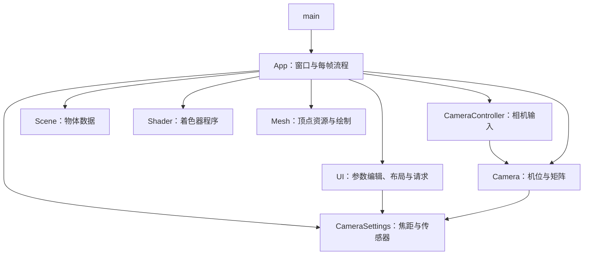

# 09 代码结构与职责

最后更新：2026-10-13。

[项目总览](00-项目总览与开发顺序.md) · [开发顺序与进度](08-小项目拆分与模块化推进.md) · [工程使用说明](../Photograph/README.md) · [维护规则](../agent.md)

本文说明当前实际代码：每个文件做什么，类与函数如何分工，程序从启动到退出怎样执行。代码结构变化时，在同一次修改中更新对应章节。功能方案见 00～07，任务状态见 08；本文以源码为准。

当前已有自由取景、五个立方体实例、焦距投影、最小 ImGui 面板与实验 A 复位。App 持有唯一 CameraSettings，CameraController 管机位输入，UI 管控件和布局；独立 Renderer、曝光、后处理和拍照保存尚未实现。P03 构建/启动检查通过，效果待用户手动验收。

## 1. 文件速查

头文件 `.h` 声明类、成员和接口，便于其他文件调用；对应 `.cpp` 实现具体行为。`main.cpp` 是程序入口，两个 `.txt` 文件保存 GPU 执行的 GLSL 源码。

下表路径相对 `Photograph/`：

| 文件 | 功能与职责 | 主要使用者 |
|---|---|---|
| [src/main.cpp](../Photograph/src/main.cpp) | 识别可选自检参数，创建 App，返回程序退出结果 | 程序入口 |
| [src/App.h](../Photograph/src/App.h)、[src/App.cpp](../Photograph/src/App.cpp) | 窗口、初始化、回调转发、输入分配、主循环和退出清理；当前也直接组织场景绘制 | main |
| [src/CameraController.h](../Photograph/src/CameraController.h)、[src/CameraController.cpp](../Photograph/src/CameraController.cpp) | 键盘移动输入、鼠标观察状态、捕获/释放、坐标差值和复位操作 | App |
| [src/Camera.h](../Photograph/src/Camera.h)、[src/Camera.cpp](../Photograph/src/Camera.cpp) | 机位、朝向、移动/旋转计算、观察矩阵和投影矩阵 | CameraController、App |
| [src/CameraSettings.h](../Photograph/src/CameraSettings.h) | 唯一焦距设置、固定传感器常量、焦距校验、FOV 和比例计算 | App、Camera、UI |
| [src/UI.h](../Photograph/src/UI.h)、[src/UI.cpp](../Photograph/src/UI.cpp) | ImGui 生命周期、参数控件、复位请求、布局和输入捕获状态 | App |
| [src/ViewportRect.h](../Photograph/src/ViewportRect.h) | 窗口逻辑坐标下的真实取景矩形及鼠标命中 | UI、App |
| [src/Scene.h](../Photograph/src/Scene.h)、[src/Scene.cpp](../Photograph/src/Scene.cpp) | 保存物体的模型矩阵与颜色乘子，初始化场景布局 | App |
| [src/Mesh.h](../Photograph/src/Mesh.h)、[src/Mesh.cpp](../Photograph/src/Mesh.cpp) | 单位立方体顶点、逐面颜色、VAO/VBO 和实际绘制调用 | App |
| [src/Shader.h](../Photograph/src/Shader.h)、[src/Shader.cpp](../Photograph/src/Shader.cpp) | 读取外部 GLSL、编译、链接、错误日志和程序资源释放 | App |
| [shaders/vertex.txt](../Photograph/shaders/vertex.txt) | 将物体局部顶点变换到裁剪空间 | Shader 加载，GPU 执行 |
| [shaders/fragment.txt](../Photograph/shaders/fragment.txt) | 输出当前面的颜色 | Shader 加载，GPU 执行 |
| [scripts/setup-deps.ps1](../Photograph/scripts/setup-deps.ps1) | 下载并校验 GLFW、GLM 依赖，解压到 `.deps/` | 首次准备开发环境 |
| [Dependencies.props](../Photograph/Dependencies.props) | 公共编译/链接设置、依赖路径、输出路径、DLL 复制和依赖检查 | Visual Studio / MSBuild |
| [Photograph.vcxproj](../Photograph/Photograph.vcxproj) | 登记源文件、头文件、构建配置与着色器复制规则 | Visual Studio / MSBuild |
| [Photograph.vcxproj.filters](../Photograph/Photograph.vcxproj.filters) | 组织 Visual Studio 中的源文件、头文件和资源分组 | Visual Studio |
| [Photograph.slnx](../Photograph/Photograph.slnx) | 解决方案入口，关联 Photograph 工程和平台 | Visual Studio |

## 2. 模块调用与数据归属

App 持有 Camera、CameraController、CameraSettings 和 Scene 成员，以及指向 UI、Mesh、Shader 的 `unique_ptr`。UI 编辑 App 传入的同一份设置并产生复位请求，App 执行请求并分配输入；Controller 操作 Camera。Camera 读取 settings 计算投影，App 读取矩阵和 Scene 实例，调用 Mesh 绘制场景，最后 UI 合成面板。

| 数据 / 资源 | 保存者 | 怎样使用 |
|---|---|---|
| `window`、`glfwInitialized` | App | 管理窗口、上下文与 GLFW 生命周期 |
| `position`、`front/right/up`、`yaw/pitch`、`speed/sensitivity` | Camera | 保存机位和运动参数，计算位移、朝向与矩阵 |
| `mouseLookActive`、`lastCursorX/Y` | CameraController | 判断是否观察，计算鼠标相对上帧的位移 |
| `focalLengthMm` | App 的 CameraSettings | UI、预设与滚轮共用校验修改；Camera 读取投影参数 |
| `sensorWidthMm/HeightMm`、焦距范围与默认值 | CameraSettings 静态常量 | 固定全画幅 3:2 传感器，不随窗口缩放 |
| `viewport` | UI | 保存逻辑坐标；App 用于命中并换算 framebuffer viewport |
| ImGui 上下文、GLFW/OpenGL3 后端及其 GPU 资源 | UI | 接收事件、建立 UI 帧和合成控件；析构释放 |
| `objects`，每项含 `model`、`tint` | Scene | App 逐项读取，决定每个实例在哪里、是什么颜色 |
| `VAO`、`VBO` | Mesh | 保存 GPU 顶点布局和顶点数据 |
| 着色器程序 `ID` | Shader | App 使用它查询 uniform，Shader 启用与释放程序 |

CameraController 每次调用时接收窗口指针和 Camera 引用，不保存它们，也不注册回调。Camera、CameraController、CameraSettings、ViewportRect 和 Scene 不持有 GPU 资源。App、UI、Mesh 和 Shader 禁止复制与移动，避免窗口或 OpenGL 资源重复释放。

## 3. 入口与 App

### 3.1 main.cpp

`main(argc, argv)` 只做三件事：检查第一个参数是否为 `--smoke-test`，创建局部 `App app`，返回 `app.run(smokeTest)` 的结果。

普通启动进入带焦距面板的可交互窗口；`--smoke-test` 进入已有的 900×600 隐藏窗口自检，不创建 UI，使用默认 50 mm 投影。该自检仅在用户明确要求时运行，默认修改后的检查使用普通启动。

### 3.2 App.h / App.cpp

App 是整体协调者。它知道窗口是否有焦点、每帧何时更新，以及各模块按什么顺序工作。当前尚未拆出 Renderer，所以绘制流程也暂放在 App 中。

| 函数 / 代码块 | 做什么 |
|---|---|
| `errorCallback(code, message)` | 文件内辅助函数，输出 GLFW 错误编号和消息 |
| `App()` | 使用默认构造；成员对象建立初始状态，窗口与 GPU 初始化在 `run()` 时进行 |
| `run(smokeTest)` | 先调用 `initialize()`，失败返回 `-1`；成功后进入 `renderLoop()` 并返回其结果 |
| `initialize(smokeTest)` | 初始化 GLFW，创建 OpenGL 3.3 Core 窗口与失焦回调，加载 GLAD，创建 Shader/Mesh，普通模式初始化 UI，启用深度测试 |
| 窗口焦点回调 | 失焦时调用 Controller 的 `stopMouseLook()`，释放观察模式 |
| ImGui 官方后端回调 | 接收键盘、字符、鼠标、滚轮、焦点等事件，并串接 App 的失焦回调；App 不再注册相机键盘/鼠标回调 |
| `processInput(deltaSeconds)` | 检查焦点、UI 捕获和取景命中；处理 Esc、右键释放/按下沿、R 按下沿和滚轮焦距，允许时调用 Controller |
| `renderLoop(smokeTest)` | 轮询事件、计算时间差、跳过最小化、建立 UI 帧和编辑设置、执行复位请求、处理输入、换算 viewport、读取矩阵、绘制场景/UI 并交换缓冲 |
| `renderLoop()` 的自检分支 | 读回中心颜色与深度，检查 GL 错误和已有基线条件，输出结果并退出；普通运行不进入此分支 |
| `~App()` | 在上下文有效时先释放 UI，再释放 Mesh/Shader，最后销毁窗口并终止 GLFW；初始化失败也走此清理路径 |

`initialize()` 的普通窗口为 1200×600，右侧初始取景区域为 900×600；正常模式启用交换间隔 1，自检模式使用 900×600 隐藏窗口和交换间隔 0。GLFW、窗口、GLAD、Shader 或 UI 初始化失败时输出相应日志并返回失败。

`renderLoop()` 每帧限制移动时间差最大为 0.1 秒。即使最小化也刷新时间基准；framebuffer 宽或高为零时结束观察、等待事件并跳过绘制。普通模式使用 UI 的逻辑取景矩形，分别按 framebuffer/window 的 X/Y 比例换算到像素，Y 坐标转为 OpenGL 左下原点；显示区域在面板右侧按 3:2 居中留边。

App 保留输入分配责任。UI 的 WantCaptureMouse/WantCaptureKeyboard/WantTextInput 及活动控件优先于相机操作；鼠标在真实取景矩形内或观察已开启时才更新机位。右键按下必须命中取景器，释放、失焦或 UI 接管时结束观察。R 只复位机位；面板请求分别恢复机位、50 mm 或“机位 + 24 mm”。未观察且命中取景器时滚轮每单位改变 2 mm，限制到 24～85 mm 后共用设置校验。Controller 接收已经允许的操作。

## 4. 相机操作与相机计算

### 4.1 CameraController.h / CameraController.cpp

Controller 把 GLFW 键鼠状态转换为相机动作，集中保存观察模式和鼠标坐标基准。

| 函数 | 做什么 |
|---|---|
| `update(window, camera, deltaSeconds)` | 先处理鼠标转向，再组合 WASD/QE 移动方向并调用 `camera.move()` |
| `startMouseLook(window)` | 开启观察状态，禁用普通光标并捕获鼠标，立即读取当前位置作为基准 |
| `stopMouseLook(window)` | 关闭观察状态，恢复普通光标 |
| `resetPose(window, camera)` | 调用 `camera.resetPose()`，随后结束鼠标观察 |
| `isMouseLookActive()` | 只读提供观察状态，供 App 输入门控及 UI 鼠标屏蔽使用 |
| `processMouseMovement(window, camera)` | 私有函数；仅在观察状态下读取鼠标位置，计算差值、更新基准并调用 `camera.rotate()` |

移动输入定义为 `z=W-S`、`x=D-A`、`y=E-Q`。鼠标差值为 `deltaX=x-lastCursorX`、`deltaY=lastCursorY-y`，因此向右移动鼠标向右转，向上移动鼠标向上看。

捕获后立即记录基准，避免把进入观察前的鼠标位移用于旋转；旋转使用坐标差值，不乘时间差。Controller 的 `update()` 不自行检查焦点，调用前由 App 判断输入是否可用。

### 4.2 Camera.h / Camera.cpp

Camera 保存“从哪里看、朝哪里看”，并执行运动与矩阵计算。它依赖 GLM，不读取 GLFW 按键、鼠标或 UI。

| 函数 | 做什么 |
|---|---|
| `Camera()` | 调用 `resetPose()` 建立初始机位和方向 |
| `resetPose()` | 恢复位置 `(0, 1.2, 3)` 米、yaw=-90°、朝向原点的 pitch，并更新方向基向量 |
| `updateDirections()` | 私有函数；根据 yaw/pitch 计算 `front`，通过叉积计算 `right` 和 `up` |
| `viewMatrix()` | 使用位置、前向和上向调用 `glm::lookAt()`，返回观察矩阵 |
| `projectionMatrix(const CameraSettings& settings)` | 从焦距/传感器计算垂直 FOV 与 1.5 比例，返回透视投影；近远裁剪面仍为 0.1/100 米 |
| `move(localDirection, deltaSeconds)` | 沿本地 right、世界竖直方向和 front 组合移动向量，归一化后按速度与时间差更新位置 |
| `rotate(deltaX, deltaY)` | 按灵敏度累加 yaw/pitch，将 pitch 限制到 ±89°，再更新方向基向量 |
| `getPosition()`、`getFront()` | 提供位置和前向的只读引用 |

当前移动速度为 2.5 米/秒，鼠标角度增益为 0.05°/坐标单位。组合方向归一化，避免斜向或同时上升前进时加速。移动允许自由飞行，沿 front 前进会随俯仰改变高度；Q/E 始终沿世界竖直方向。尚未加入碰撞。

### 4.3 CameraSettings.h

CameraSettings 是普通参数结构，App 持有唯一可编辑实例。当前只实现焦距，默认 `focalLengthMm=50`；36×24 mm 传感器、24～85 mm 范围和默认值为静态常量。曝光与对焦字段尚未加入。

| 函数 | 做什么 |
|---|---|
| `setFocalLengthMm(value)` | 有限且在 24～85 mm 内才写入；无效值返回 false，保持原参数 |
| `verticalFovRadians()` | 返回 `2*atan(sensorHeightMm/(2*focalLengthMm))`，结果已是弧度 |
| `aspectRatio()` | 返回 `sensorWidthMm/sensorHeightMm`，当前为 1.5 |

UI 使用局部候选值接收滑块/精确输入，再通过 setter 写回；预设、独立复位、实验复位和滚轮也使用同一 setter。Camera 只读取设置，不修改焦距或机位；没有另一份 FOV/Zoom 可编辑状态。

### 4.4 UI.h / UI.cpp

UI 拥有一个 ImGui 上下文及官方 GLFW/OpenGL3 后端。控件编辑焦距，但不直接调用 Camera 移动或复位；`UIRequests` 中三个布尔值只表示本帧的机位/焦距/实验复位请求，由 App 执行。

| 函数 | 做什么 |
|---|---|
| `initialize(window)` | 创建上下文、禁用 ini 保存、启用键盘导航、初始化官方后端并创建 UI GPU 资源；失败输出日志 |
| `beginFrame(mouseLookActive)` | 观察时设置 NoMouse，防止 GLFW 虚拟鼠标坐标误触控件；随后调用两个后端 NewFrame 和 ImGui::NewFrame |
| `draw(settings, camera)` | 计算右侧真实取景矩形，绘制焦距预设/滑块、FOV/机位读数、复位按钮与操作说明，返回请求 |
| `render()` | 生成 ImGui draw data，调用 OpenGL3 后端合成面板 |
| `getViewportRect()` | 返回本帧逻辑坐标下的取景矩形 |
| `capturesMouse()`、`capturesKeyboard()` | 提供官方捕获标志和活动控件门控 |
| `rightMousePressed()`、`resetPosePressed()`、`mouseWheel()` | 提供 ImGui 按下沿和本帧滚轮数据，由 App 决定是否消费 |
| `~UI()` | 按初始化状态清理 OpenGL3 后端、GLFW 后端和上下文，恢复串接前回调；需在 GLFW 窗口销毁前调用 |

左侧面板宽度取 `min(300, windowWidth*0.4)`，右侧区域按固定 3:2 留边。焦距预设从实际值推导选中状态；可用宽度不足时改为两列。使用 ImGui 默认字体和英文标签，不增加字体文件或无功能的摄影状态。

### 4.5 ViewportRect.h

保存 `x/y/width/height`，单位为窗口逻辑坐标，原点在左上。UI 写入真实取景显示位置和尺寸；`contains(cursorX,cursorY)` 使用左/上包含、右/下不包含的边界判断，App 用它排除面板与留边。当前没有照片纹理或点击对焦，纹理像素坐标换算留到 P06。

## 5. 场景、几何与着色器

### 5.1 Scene.h / Scene.cpp

`SceneObject` 是物体实例的数据结构：`model` 表示模型矩阵，`tint` 表示颜色乘子。Scene 保存实例数据；所有实例复用 App 持有的同一个单位立方体 Mesh。

| 函数 / 代码块 | 做什么 |
|---|---|
| `Scene()` | 建立地面、原点处的前景主体和三个远景参照物，共五个实例 |
| 构造函数内的 `addCube` lambda | 按位置、绕世界 Y 轴的角度和缩放生成模型矩阵，把矩阵与颜色乘子加入 `objects` |
| `getObjects()` | 返回实例列表的只读引用，供 App 遍历 |

模型矩阵为 `T * R * S`，作用到顶点时先缩放、再旋转、最后平移。地面上表面为 y=-0.5，与前景主体底面相接。三个远景中心 Z 分别为 -3/-6/-9 米，用于空间参照；它们并非已经实现的对焦距离预设。

当前 Scene 没有时间更新、灯光、模型加载或绘制函数。

### 5.2 Mesh.h / Mesh.cpp

Mesh 保存可重复绘制的几何资源。当前实现是中心位于原点、边长为 1 的立方体，不是通用模型加载器。

| 函数 / 数据 | 做什么 |
|---|---|
| `vertices` | 文件内常量；六个面各两个三角形，共 36 个顶点，每个顶点只有三维位置 |
| `faceColors` | 文件内常量；六个面分别使用不同深浅的颜色，帮助观察形状 |
| `Mesh()` | 创建 VAO/VBO，上传顶点数据，将位置属性登记为 location 0 的三个 float |
| `draw(faceColorLocation, tint)` | 绑定 VAO，逐面设置 `faceColors[face] * tint`，每面绘制六个顶点，共六次 `glDrawArrays()` |
| `~Mesh()` | 删除 VAO 和 VBO；调用时需要有效的 OpenGL 上下文 |

调用 `draw()` 前，App 已启用 Shader 并设置 model/view/projection。Mesh 只设置每面颜色和发出绘制调用，不决定物体摆放或相机矩阵。当前颜色深浅来自固定常量，尚未计算真实光照。

### 5.3 Shader.h / Shader.cpp

Shader 管理一个链接后的 OpenGL 程序，处理文件读取、编译、链接及错误输出。

| 函数 / 成员 | 做什么 |
|---|---|
| `Shader(vertexPath, fragmentPath)` | 确定 exe 所在目录，读取两个文件，编译顶点/片段着色器并链接程序；释放临时着色器对象 |
| `checkCompileErrors(shaderID, type)` | 私有函数；根据类型查询编译或链接状态，失败时输出完整日志并返回 false |
| `ID` | 保存程序句柄，公开供 App 查询 uniform；加载、编译或链接失败时保持为 0 |
| `use()` | 调用 `glUseProgram(ID)`，启用该程序 |
| `~Shader()` | ID 非零时删除程序；调用时需要有效的 OpenGL 上下文 |

路径通过 `GetModuleFileNameW()` 从 exe 所在目录解析，不依赖启动时的工作目录。文件缺失、读取失败、GLSL 编译失败或链接失败均输出日志；App 检查 `ID==0` 后终止初始化。

### 5.4 vertex.txt / fragment.txt

两个文件都使用 GLSL 330 Core，各有自己的 GPU 入口 `main()`：

| 着色器 | 输入 | 执行内容与输出 |
|---|---|---|
| `vertex.txt` | `aPos`（location 0）；`model`、`view`、`projection` uniform | 计算 `gl_Position = projection * view * model * vec4(aPos, 1.0)` |
| `fragment.txt` | `faceColor` uniform | 写出 `FragColor = vec4(faceColor, 1.0)`，alpha 为 1 |

矩阵的数据来源：model 来自 Scene，view 来自 Camera，projection 由 Camera 读取 App 的 CameraSettings 计算，均由 App 上传。faceColor 来自 Mesh 的逐面颜色与 Scene 的 tint，由 Mesh 上传。

当前场景直接向窗口的取景 viewport 绘制，之后合成 UI；尚未加入照片纹理、HDR 帧缓冲、景深或曝光计算。

## 6. 从启动到退出

1. `main()` 创建 App。Camera 复位机位、CameraSettings 建立默认 50 mm、Scene 生成五个实例；此时不创建 GPU 资源。
2. `App::run()` 调用 `initialize()`：初始化 GLFW → 创建窗口和当前上下文 → 注册失焦回调 → 加载 GLAD → 创建 Shader/Mesh → 普通模式初始化 UI 和后端回调 → 开启深度测试。
3. `renderLoop()` 查询 uniform 位置。每帧轮询事件、更新时间并检查 framebuffer；最小化时释放观察、等待事件、跳过 UI 和绘制。
4. 普通模式先建立 UI 帧、编辑同一份 settings、执行复位请求，再调用 `processInput()`。允许相机操作时 Controller 先旋转再移动；滚轮只改焦距。App 将 UI 取景矩形换算到 framebuffer，读取 Camera 的 view 和 settings 对应投影，启用 Shader、遍历 Scene 并调用 Mesh 绘制；随后 UI 合成并交换缓冲。自检不创建 UI，沿用完整 3:2 区域和颜色/深度分支。
5. Esc 或窗口关闭请求结束循环。`run()` 返回后，App 析构先释放 UI，再释放 Mesh/Shader，最后销毁窗口并终止 GLFW，程序返回退出结果。

初始化失败返回 `-1` 并通过 App 析构清理已建立的资源；正常关闭返回 0。可选自检的检查失败也返回 `-1`。

## 7. 工程文件、依赖与辅助代码

| 文件 / 目录 | 职能与维护方式 |
|---|---|
| `Photograph.slnx` | 让 Visual Studio 打开工程；解决方案列出 x64/x86 平台，工程使用 x64/Win32 配置 |
| `Photograph.vcxproj` | 提供 v145、Debug/Release × x64/Win32 构建配置，导入 Dependencies.props，登记源码与头文件，并将着色器复制到输出目录 |
| `Photograph.vcxproj.filters` | 仅影响 IDE 文件分组；新增 `.cpp/.h` 时与工程文件同步登记 |
| `Dependencies.props` | 配置 C++17、UTF-8、/W4、包含路径（含 ImGui）、GLFW/OpenGL 链接、编译宏、bin/obj 输出目录，检查依赖并复制 GLFW DLL |
| `scripts/setup-deps.ps1` | 下载 GLFW 3.4 的 Win64/Win32 包、GLM 1.0.1 和 Dear ImGui 1.91.9b，核对 SHA256，解压并确认目录存在；已有下载包也检查哈希 |
| `.deps/` | 本地依赖及下载缓存，由准备脚本建立，按现有忽略规则保留在本地 |
| `.deps/imgui-1.91.9b/` | 固定版本第三方核心源码和 GLFW/OpenGL3 后端由工程直接编译；不修改第三方源码 |
| `third_party/glad/` | OpenGL 加载器源码、头文件和许可证；由工程编译 `glad.c`，App 调用加载接口；作为第三方实现维护 |
| `bin/`、`obj/` | 构建产物与中间文件；bin 含 exe、GLFW DLL 和复制的 shaders，业务代码修改源目录 |
| `Photograph/tests/`、`文档/验收/` 中的脚本 | 已有本地数值和窗口专项检查及历史证据；按用户明确要求运行，默认修改后不执行整套复验 |

GLFW 负责窗口、事件和输入；GLM 提供数学类型与矩阵函数；GLAD 加载场景 OpenGL 函数。ImGui 管控件和 UI 输入，官方 OpenGL3 后端使用其自带加载器，仅合成 UI 并恢复场景状态。详细构建、依赖和运行命令统一见工程 README。

## 8. 想改某个行为时先看哪里

| 要修改的行为 | 主要位置 | 关联位置 |
|---|---|---|
| 窗口、Esc、焦点处理、每帧顺序 | App | main、CameraController |
| WASD/QE 移动映射、鼠标坐标处理、捕获/释放 | CameraController | App 的事件转发与输入判断 |
| R 快捷键映射 | App 的 `processInput()`、UI 的按下沿查询 | CameraController 的 `resetPose()` |
| 焦距、传感器、范围和 FOV | CameraSettings、Camera 投影 | UI 控件、App 滚轮/复位 |
| 面板、预设、复位按钮、布局 | UI | App 的请求执行和输入分配、ViewportRect |
| 取景命中及高 DPI viewport 换算 | ViewportRect、UI、App | CameraSettings 的固定比例 |
| 速度、灵敏度、初始机位、俯仰限幅 | Camera | CameraController、App 的矩阵上传 |
| 物体数量、位置、缩放和颜色乘子 | Scene | App 的实例遍历、Mesh 的逐面颜色 |
| 立方体顶点、每面颜色和绘制方式 | Mesh | vertex.txt、fragment.txt |
| 顶点变换或像素颜色公式 | vertex.txt、fragment.txt | App/Mesh 上传的 uniform |
| 着色器加载路径、编译和链接错误 | Shader | App 的初始化检查、工程复制规则 |
| 新文件编译、依赖或输出资源 | vcxproj、filters、Dependencies.props | setup-deps.ps1、工程 README |

## 9. 后续模块与更新约定

CameraSettings、UI 和 ViewportRect 已在 P03 接入；Renderer、PostProcess、Capture 以及曝光/对焦等设置仍属于后续计划。新增实际文件后按同样方式补充速查、函数职责、调用关系和数据归属；渲染流程从 App 移出时，同时修正 App 的实际职责。

本文持续更新规则：

- 新增、删除、重命名或移动源码、着色器、工程辅助文件时，同步调整文件表及链接。
- 类、函数、数据成员的职责或接口变化时，同步更新对应章节；调用顺序、资源归属、输入处理或错误路径变化时，更新流程说明。
- 未实现的功能保留在“后续模块”，有实际代码后再加入当前结构。
- 每次相关代码修改都核对本文；结构或行为说明受到影响时，在同一任务中修改正文和最后更新日期。无关章节不必改写。
- agent.md 负责维护要求，本文负责实际结构，08 负责进度，README 负责操作；历史验证结果继续保留在原记录中。
- 默认检查仍为当前配置构建和程序启动运行不报错；运行效果由用户手动检查。纯文档修改只检查文档。
