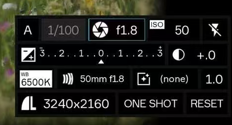

# 10 摄影 HUD 风格与实现方案

研究及排期更新日期：2026-10-13。状态：研究完成，摄影 HUD 暂缓实施，计划在 P10 的界面整理阶段开始。按用户最新要求，当前 ImGui 面板保留为开发与调试界面；先推进核心摄影功能，不制作 P03 的四行风格版。以下外观与交互方案均为后续计划。

[界面与验收](07-界面与验收.md) · [代码结构与职责](09-代码结构与职责.md) · [任务进度](08-小项目拆分与模块化推进.md#7-执行记录)

## 1. 结论

可以在现有 C++ / OpenGL / Dear ImGui 1.91.9b 工程中实现接近参考图的摄影控制面板。继续使用官方 GLFW/OpenGL3 后端，改用紧凑无标题窗口、自绘分格和文字、图标字体，以及有真实输入响应的自定义参数控件。

主要工作在字体、图标、分格比例和输入命中。Camera、相机移动算法和摄影投影不需要因外观变化而重写。HUD 指叠加在取景画面上的控制区；完整照片仍保持 3:2。

当前保留已有侧栏、默认字体和标准控件。P04～P09 只在该面板中补充对应功能需要的参数、调试读数、效果开关和任务反馈；正式 HUD 的字体、图标和布局集中在 P10 处理，原面板届时作为可开关的调试入口保留。启动条件见第 8 节。

## 2. 参考图与可确认范围

用户提供的图像为 474×256 像素，面板可见区域约 440×210 像素；这是局部截图，无法确定它在原完整画面中的位置。参考图保存在仓库内，仅作研究依据，不作为运行时背景或图标素材。

| 行 | 图中可见内容 | 对本项目的意义 |
|---|---|---|
| 第一行 | A、1/100、光圈符号与 f1.8、ISO 50、闪光关闭符号 | 紧凑参数格，大数字，标签嵌在格子角落；光圈格有浅青色选中边框 |
| 第二行 | 正负号图标、左右 3/2/1 到中央 0 的刻度、三角标记、半明半暗圆与 +.0 | 用连续刻度表达曝光相关信息；真实数值和标记必须有计算依据 |
| 第三行 | WB 6500K、镜头相关符号与 50mm f1.8、(none)、1.0 | 小标签与紧凑镜头摘要，局部采用白底黑字 |
| 第四行 | 左侧图形、3240×2160、ONE SHOT、RESET | 状态与操作排列在同一行，尺寸和按钮文字共用稳定的视觉基线 |

图中 A 按摄影惯例可能表示光圈优先，但不能据此声称本项目已实现自动曝光。`(none)`、右端 `1.0` 和 `ONE SHOT` 的确切行为仅凭截图无法确认；尤其不把 `ONE SHOT` 直接认定为拍照按钮。图中输出尺寸也不能代替项目当前的实际渲染或未来导出尺寸。

## 3. 风格拆解

| 元素 | 观察结果 | 建议实现起点 |
|---|---|---|
| 面板底色 | 接近黑色，画面背景只在面板外围明显可见 | 近黑、不透明或接近不透明；透明度最终按实际场景调节 |
| 分格 | 灰黑边框和很窄的间隔，外轮廓较厚 | 四行独立列宽；分格间距约 4～6 个逻辑像素 |
| 形状 | 方形轮廓，没有明显圆角 | Window/Frame rounding 设为 0 |
| 主文字 | 白色或近白，较大，无衬线，字重较轻 | 静态无衬线字体，参数约 22～26 px，摘要约 18～20 px |
| 小标签 | ISO、WB 以很小的文字紧贴对应值 | 标签约 10～12 px；部分标签使用白底黑字 |
| 选中状态 | 浅青色细线包围当前参数 | 约 1 px 边框，轻微内层描边；避免大面积亮蓝填充 |
| 次要状态 | 部分文字较暗 | 用灰色表示次要/禁用项，仍保留可辨识的文字 |
| 图标 | 白色摄影符号，几何轮廓明确 | 从摄影相关图标库选择一致风格，单独调整大小和基线 |

以上颜色、字号和尺寸是从截图观察得到的实现建议，不是原软件的精确设计参数。原图经过截图压缩，具体字体无法可靠识别；不把模糊边缘作为需要复制的效果。

## 4. ImGui 实现方法

### 4.1 面板和分格

创建尺寸仅覆盖 HUD 的窗口，使用 `NoTitleBar`、`NoResize`、`NoMove`、`NoCollapse`、`NoSavedSettings` 等公开标志，按四行和各自列宽安排控件。使用窗口的 `ImDrawList` 绘制背景、内边框和文字；小标签可独立画白色矩形及黑色文字。

`AddRectFilled()`、`AddRect()`、`AddText()` 足以完成这些基础元素，刻度线和三角指示器也由绘制接口生成。`InvisibleButton()` 提供稳定 ID、命中区域和点击状态，配合 `ImGuiButtonFlags_EnableNav` 保留键盘导航能力；精确数值编辑继续使用原生控件，放在参数弹窗中。以上接口已在本地 1.91.9b 头文件核对，见[该版本官方 API](https://github.com/ocornut/imgui/blob/v1.91.9b/imgui.h)。

不能只向 draw list 写出按钮外形，否则没有控件输入行为。也不要建立覆盖整个取景器、却没有输入穿透规则的透明 UI 窗口，否则它会截获整幅画面的相机输入。

### 4.2 字体

当前 UI 使用默认 ProggyClean 像素字体，与参考图的大号平滑数字差异明显。官方文档说明可以加载 TTF/OTF，默认字体不适合平滑缩放，见[字体说明](https://github.com/ocornut/imgui/blob/v1.91.9b/docs/FONTS.md)。

最小接入可以先使用本地 ImGui 包里的 `misc/fonts/Roboto-Medium.ttf`，但该字重比参考图偏厚；进一步还原时使用静态 Regular/Light 字重，并携带所选字体的实际许可。数字、小标签和摘要分别加载需要的字号；涉及中文说明时另补所需中文字形。

字体应在 UI GPU 资源创建之前加载；不能只放大当前像素字体。高 DPI 使用内容缩放和字体重建控制清晰度，与窗口逻辑尺寸、framebuffer 像素转换分别处理；在内容缩放变化时调整，不每帧重建字体图集。

资源从 exe 所在目录解析，并通过工程复制规则放入输出目录。字体缺失需要日志和可理解的回退行为，不能依赖开发机器的系统字体路径。

### 4.3 图标

优先使用 Google Material Icons 的静态图标字体，为光圈/快门、曝光、闪光关闭、相机等选择接近参考的符号；官方提供图标字体及图像资源，并采用 Apache 2.0 许可，见[官方指南](https://developers.google.com/fonts/docs/material_icons)和[字体目录](https://github.com/google/material-design-icons/tree/master/font)。

只加载需要的 glyph 范围，统一图标大小和垂直基线。缺少合适字形时可以使用独立图标 PNG 或小图集，通过纹理显示；不需要在运行时加入 SVG 渲染器。参考截图中的左下图形不直接作为项目标志使用。

这能得到相近的摄影符号，但不能承诺与原图的私有图标逐像素一致；最终差异主要来自字体、字重及图标形状。

## 5. 放进当前工程

当前 `UI::draw()` 固定预留左侧面板宽度，App 根据 UI 返回的 ViewportRect 绘制剩余区域；P04～P09 延续这个调试布局。进入 P10 的 HUD 任务后，再改成完整窗口居中显示 3:2 取景器，HUD 叠加在该矩形左下，原有参数说明和机位细节放入可收起的调试/实验面板。

参考图没有完整画面，所以左下是本项目建议，并非对原软件位置的判断。HUD 起始尺寸约 440×210 个逻辑像素；相对取景器边缘预留 12～16 px，按可用空间与 DPI 调整。窗口过窄时缩为紧凑两行或收起详细行，避免把文字无限缩小。

HUD 叠加不改变 CameraSettings 或投影，窗口缩放也不能裁切照片来给 HUD 腾位置。当前继续直接向默认 framebuffer 绘制场景，再合成现有调试 UI；P04 接入照片 FBO，P05 从 UI 合成前的照片目标保存。P10 再调整展示布局，沿用已经稳定的“先照片、后 UI”顺序。

| 文件 | 拟修改内容 |
|---|---|
| `UI.h/.cpp` | P10 接入字体、HUD 布局、分格控件、选中状态和参数弹窗；保留可开关的调试/实验面板 |
| `App.cpp` | 消费控件请求和已分流输入；继续使用 UI 返回的真实取景矩形 |
| `ViewportRect.h` | 保留逻辑坐标与命中约定；不因 HUD 叠加而缩减照片矩形 |
| `CameraSettings.h` | 当前焦距继续是唯一值来源；新摄影字段按对应功能任务接入 |
| 工程文件与资源目录 | 登记字体/图标资源、输出复制规则与许可文件；不预建通用 UI 框架 |

UI 内部先提取少量有明确用途的辅助函数，例如参数格、标签和刻度；不为四行面板建立复杂控件系统。

## 6. 核心功能与后续摄影面板

不再安排 P03 的黑白四行版本。先通过现有调试面板把各项功能做通，正式 HUD 开始时按所选交付范围映射已实现参数，避免在每个算法阶段重做外观。

| 行 | 正式 HUD 计划内容 | 数据与功能前置 |
|---|---|---|
| 第一行 | 实际生效的手动曝光参数：快门、光圈和 ISO，选中格显示细边框 | P04 曝光通过；只显示实际支持的模式 |
| 第二行 | 已有曝光倍率/读数；有对应计算时再提供曝光刻度 | 使用 P04 已有数据；没有测光或补偿算法时不伪造读数和指示器 |
| 第三行 | 焦距与传感器摘要，目标版本增加对焦距离和有效对焦反馈 | P03 焦距；包含对焦时要求 P06 通过 |
| 第四行 | 真实照片尺寸、拍照反馈、机位/参数/实验复位；目标版本增加采样进度 | P05 保存；包含多时间采样时要求 P08 通过 |

P04/P05/P06/P08 先把上述控件和状态接入标准调试面板，不同步制作摄影 HUD。A/S 自动曝光、白平衡、滤镜、闪光灯仍是选做功能，不因模仿面板而自动纳入核心范围。

当前不写死截图中的 f1.8、ISO 50、6500K 或 3240×2160。若以后专门制作完整布局展示，未实现项目必须明确禁用，不能把展示值描述成已生效设置。

## 7. 输入和交互

- 单击参数格选中或打开紧凑编辑弹窗，数值继续写入同一份 CameraSettings。
- 悬停焦距格或焦距刻度时可处理滚轮；同一滚轮事件不能同时触发取景器变焦。
- HUD、文本编辑、弹窗先接收输入，未被占用的取景区域再交给 App/CameraController。保留现有观察期间 NoMouse 处理和右键释放路径。
- R 仍只复位机位；实验 A 操作同时恢复初始机位与 24 mm，不把两种复位合并成含义不明的 RESET。
- 方向键导航和逐档编辑接入时，要和 ImGui 键盘导航统一处理，避免一个按下事件触发两次调整。
- 使用实际 ImGui 窗口/控件捕获状态，不能只靠图标所在像素或 HUD 外形猜测输入占用。依据为[官方输入分配说明](https://github.com/ocornut/imgui/blob/v1.91.9b/docs/FAQ.md#q-how-can-i-tell-whether-to-dispatch-mousekeyboard-to-dear-imgui-or-my-application)。

## 8. 启动阶段、实施顺序与验收

### 8.1 放在哪个阶段

正式 HUD 默认放在 **P10 / 阶段 G 的前半段**，前置是所选交付范围的核心功能已完成并验收：完整目标版本在 P09 验收后开始；若确定只交最低版本，则可在 P05 验收后进入 P10，按已完成范围制作简化 HUD。当前路线仍优先推进到 P09，P05 达成不自动触发外观改造。

| 节点 | 本阶段的 UI 工作 | 是否开始参考图风格改造 |
|---|---|---|
| P03 当前 | 保持已有焦距面板，完成原功能手动验收 | 不开始 |
| P04～P05 / C | 标准控件调曝光、读数与保存反馈；固定照片目标、预览/导出分离 | 最早具备基础条件，但默认继续功能开发 |
| P06～P07 / D | 深度/CoC 调试、距离读数、对焦与景深参数 | 保持调试面板 |
| P08～P09 / E/F | 时间采样进度、噪声控制、效果开关与实验联调 | 保持调试面板 |
| P10 前半段 / G | 已实现参数迁入摄影 HUD；原面板变为可开关调试入口 | 默认正式开始 |
| P10 后半段 / G | 检查布局、输入、导出隔离，修复缺陷并打包 | 收尾验收 |

P05 后已有固定照片目标、曝光参数和保存流程，因而具备最早开始 HUD 的基础；延后到 P09 后，能一次整理对焦、景深、拍摄进度和噪声状态，减少布局及输入规则反复修改。字体和图标资源也在正式 HUD 任务启动时接入，不提前增加依赖。

### 8.2 开始前检查

- 所选交付范围已经明确，对应核心功能已验收；使用现有调试 UI 可完成参数编辑、复位和拍照流程。
- 固定照片目标、预览显示和导出已分离，UI 不进入 PNG；ViewportRect 与参数唯一来源约定稳定。
- 将要显示的读数、对焦结果和采样进度有实际数据来源；没有实现的能力不加入可操作控件。
- 为布局改造后的手动检查和交付留出时间。若时间不足，保留当前调试界面完成交付，HUD 另行安排；新外观不成为最低版本的阻塞项。

### 8.3 P10 内的实施顺序

1. 按实际已实现字段确定四行内容，接入平滑字体、图标和黑白分格样式。
2. 整理完整 3:2 取景与 HUD 叠加，原侧栏保留为可开关调试/实验面板，共用同一 CameraSettings 和请求流程。
3. 完成参数格、弹窗、滚轮和快捷键输入分流，保留原机位操作、复位、参数校验和拍摄快照语义。
4. 检查 HUD/调试面板切换、缩放、对焦命中、拍摄进度和导出无 UI，修复后再记录性能、打包与整理说明。包含哪些检查按所选功能范围决定。

P10 的 HUD 任务只整理已有功能的呈现与操作，不追加曝光、景深或保存算法，也不为复刻截图增加自动曝光、白平衡等扩展。

代码修改后按项目约定只默认构建 x64 Debug、普通启动与正常关闭检查。外观、字号、边框、布局、焦距与机位变化、HUD 输入隔离、窗口缩放和高 DPI 效果由用户手动检查；当前研究没有执行程序或功能专项验证。

本轮已核对参考图、本地源码、ImGui API/字体说明及官方图标来源。尚未确定原图的精确字体、私有图标、整体界面位置或未知字段语义，不将这些推测写成已确认行为。
